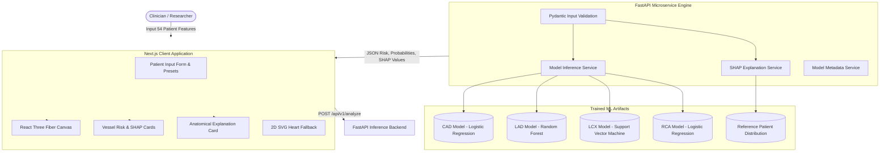

# 🫀 CardioVision 3D — Clinical AI Cardiac Anatomy & Multi-Vessel CAD Explainability Platform

[](https://fastapi.tiangolo.com)
[](https://nextjs.org/)
[](https://docs.pmnd.rs/react-three-fiber)
[](https://python.org)
[](https://www.typescriptlang.org/)
[](LICENSE)

**CardioVision 3D** is an end-to-end, medical AI decision-support platform designed to bridge machine learning risk assessments with interactive 3D cardiac anatomy. The platform evaluates Coronary Artery Disease (**CAD**) and specific vessel stenosis risks across the major coronary branches (**LAD**, **LCX**, **RCA**), computes local **SHAP** feature attributions, and maps risk profiles onto real-time 3D heart models and Premature Ventricular Contraction (**PVC**) localization markers.

---

## 📑 Table of Contents

- [Key Platform Features](#-key-platform-features)
- [System Architecture](#-system-architecture)
- [Machine Learning & Explainability Engine](#-machine-learning--explainability-engine)
- [Interactive 3D Heart & Anatomical Mapping](#-interactive-3d-heart--anatomical-mapping)
- [Repository Structure](#-repository-structure)
- [Getting Started](#-getting-started)
  - [Prerequisites](#prerequisites)
  - [Backend Setup (FastAPI)](#1-backend-setup-fastapi)
  - [Frontend Setup (Next.js)](#2-frontend-setup-nextjs)
- [API Documentation & Endpoints](#-api-documentation--endpoints)
- [Dataset & Model Training](#-dataset--model-training)
- [Clinical Decision Support & Anatomical Cards](#-clinical-decision-support--anatomical-cards)
- [Testing & Quality Assurance](#-testing--quality-assurance)
- [Deployment](#-deployment)
- [Medical & Research Disclaimer](#-medical--research-disclaimer)

---

## ✨ Key Platform Features

- **Multi-Target Coronary Risk Inference**:
  Independent validated ML models for:
  - **CAD**: Overall Coronary Artery Disease risk.
  - **LAD**: Left Anterior Descending artery stenosis.
  - **LCX**: Left Circumflex artery stenosis.
  - **RCA**: Right Coronary Artery stenosis.
- **Local SHAP Attribution Engine**:
  Additive feature attributions quantify exactly which patient parameters (e.g., ST depression, dyspnea, ejection fraction, blood sugar) elevate or mitigate calculated risk.
- **Interactive 3D Heart Anatomy (`React Three Fiber` / `Three.js`)**:
  - Anatomically oriented 3D coronary vessel meshes (`LAD_Vessel`, `LCX_Vessel`, `RCA_Vessel`) with dynamic risk-gradient heatmaps (`Normal`, `Mild`, `Moderate`, `Severe`).
  - PVC origin hotspot markers (RVOT, LVOT, Fascicular, Papillary Muscle) with electrophysiology details.
  - Interactive camera controls: Orbit controls, anatomical preset perspectives (Anterior, Posterior, Left Lateral, Right Lateral, Superior, Inferior), and cross-sectional views.
  - Graceful fallback rendering: WebGL capability detection and 2D clinical SVG cardiovascular diagram fallback.
- **Plain-English Anatomical Risk Translation**:
  `AnatomicalExplanationCard` breaks down clinical jargon into three intuitive sections:
  1. 📍 **Where is the problem?** (Specific anatomical territory and myocardial perfusion area)
  2. ⚠️ **What is the problem?** (Target probability and clinical risk classification)
  3. 🔍 **Why is this happening?** (Top driving patient biomarkers, lab results, and ECG findings)
- **Comprehensive 54-Feature Clinical Form**:
  - Organized by diagnostic categories: Demographic & History, Symptoms & Examination, ECG Findings, Laboratory Biomarkers, and Echocardiography.
  - Pre-configured one-click clinical presets for rapid simulation and demonstration.
- **Sleek Clinical UI**:
  High-contrast, pure-black theme (`#000000` / `#09090b`) built with Tailwind CSS, custom glassmorphism panels, and Lucide icons.
- **Client-Side Simulation Fallback**:
  High-fidelity offline estimation and SHAP simulation ensure seamless presentations and demonstrations even without an active backend connection.

---

## 🏗️ System Architecture



---

## 🧠 Machine Learning & Explainability Engine

Models are trained on the **UCI Extension of Z-Alizadeh Sani Dataset** (54 features including demographic, clinical symptom, laboratory, ECG, and echocardiographic variables) using cross-validation safe pipelines:

| Target | Selected Model Architecture | Probability Calibration | Operating Threshold | Validation Strategy |
| :--- | :--- | :--- | :--- | :--- |
| **CAD (Overall)** | Logistic Regression (Default) | Uncalibrated | `0.50` | 5x5 Repeated Stratified CV |
| **LAD** | Random Forest (Balanced) | Sigmoid Calibration | `0.50` | 5x5 Repeated Stratified CV |
| **LCX** | Support Vector Machine (Balanced) | Sigmoid Calibration | `0.45` | 5x5 Repeated Stratified CV |
| **RCA** | Logistic Regression (Balanced) | Uncalibrated | `0.45` | 5x5 Repeated Stratified CV |

### Feature Groups (54 Variables)
- **Demographics & Vitals**: Age, Weight, Length (Height), BMI, Blood Pressure (BP), Pulse Rate (PR), Sex.
- **Medical History & Habits**: Diabetes Mellitus (DM), Hypertension (HTN), Current Smoker, Ex-Smoker, Family History (FH), Obesity, Chronic Renal Failure (CRF), Cerebrovascular Accident (CVA), Airway Disease, Thyroid Disease, Congestive Heart Failure (CHF), Dyslipidemia (DLP).
- **Physical Examination**: Weak Peripheral Pulse, Lung Rales, Systolic Murmur, Diastolic Murmur, Dyspnea, Functional Class (FC), Edema.
- **Symptom Profile**: Typical Chest Pain, Atypical Chest Pain, Nonanginal Chest Pain, Exertional CP (LowTH Ang).
- **ECG & Conduction**: LVH, Poor R Progression, BBB, VHD, Q Wave, ST Elevation, ST Depression, T Inversion.
- **Laboratory Biomarkers**: Fasting Blood Sugar (FBS), Serum Creatinine (CR), Triglycerides (TG), LDL, HDL, BUN, ESR, Hemoglobin (HB), Potassium (K), Sodium (Na), White Blood Cells (WBC), Lymphocytes, Neutrophils, Platelets (PLT).
- **Echocardiography**: Ejection Fraction (`EF-TTE`), Regional Wall Motion Abnormality (`Region RWMA`).

### Explainability with SHAP
- Computes additive feature contributions for every prediction.
- Ranks positive drivers (factors elevating risk) and negative drivers (factors protecting or lowering risk).
- Translates numerical attributions into clinician-friendly explanations without confusing medical association with direct causality.

---

## 🫀 Interactive 3D Heart & Anatomical Mapping

The 3D rendering pipeline uses **React Three Fiber** and custom GLTF/GLB models:

- **Coronary Mesh Binding**: Directly identifies and isolates coronary meshes (`LAD_Vessel`, `LCX_Vessel`, `RCA_Vessel`) and applies dynamic PBR materials indicating risk severity:
  - 🟢 **Normal / Low Risk**: `< 30%` probability
  - 🟡 **Mild Risk**: `30% - 50%` probability
  - 🟠 **Moderate Risk**: `50% - 70%` probability
  - 🔴 **Severe Risk**: `> 70%` probability
- **Camera Presets**: Fast perspective alignment for Anterior (Front), Posterior (Back), Left Lateral, Right Lateral, Superior, and Inferior viewing angles.
- **PVC Localization Hotspots**: Interactive hotspots placed at characteristic arrhythmic trigger zones (e.g., RVOT - Right Ventricular Outflow Tract) with electrophysiology descriptions, ECG indicators, and ablation considerations.
- **Resilient Fallback**: Automatic detection of WebGL context availability. In headless or restricted environments, the system renders an SVG 2D anatomical vascular diagram.

---

## 📁 Repository Structure

```text
ML-3D/
├── backend/                         # FastAPI Inference & Explainability Backend
│   ├── app/
│   │   ├── main.py                  # API initialization, CORS, lifespan, exception handlers
│   │   ├── config.py                # Environment configuration settings
│   │   ├── dependencies.py          # FastAPI dependency injection singletons
│   │   ├── schemas.py               # Pydantic v2 schemas for 54 features & API responses
│   │   ├── routes/
│   │   │   ├── health.py            # /api/v1/health status endpoint
│   │   │   ├── metadata.py          # /api/v1/metadata model information endpoint
│   │   │   ├── predict.py           # /api/v1/predict & /api/v1/analyze endpoints
│   │   │   └── explain.py           # /api/v1/explain target SHAP explanation endpoint
│   │   └── services/
│   │       ├── model_service.py     # Multi-vessel model loader and predictor
│   │       ├── explanation_service.py # SHAP explainer computation service
│   │       └── validation_service.py# Data alignment and feature imputation
│   ├── tests/                       # Backend test suite (pytest & httpx)
│   └── requirements.txt             # Python backend dependencies
├── frontend/                        # Next.js 14 Web Application
│   ├── app/
│   │   ├── layout.tsx               # Root layout, viewport, fonts
│   │   ├── page.tsx                 # Main CardioVision 3D Clinical Dashboard
│   │   └── globals.css              # Custom styling & animations
│   ├── components/
│   │   ├── heart/                   # 3D Heart Canvas, Orbit Controls, Hotspots, Vessels
│   │   │   ├── HeartViewer.tsx      # Core Three.js / React Three Fiber canvas
│   │   │   ├── HeartModel.tsx       # GLTF loader, material applicator, mesh targeting
│   │   │   ├── HeartControls.tsx    # Camera presets, wireframe, zoom controls
│   │   │   ├── Hotspot.tsx          # PVC origin pins & annotations
│   │   │   ├── Vessel.tsx           # Vessel interaction & shader states
│   │   │   ├── TwoDCardFallback.tsx # Interactive 2D fallback SVG diagram
│   │   │   └── heartAnatomyData.ts  # Anatomical reference data & vessel coordinates
│   │   └── dashboard/               # Clinical inputs, gauges, and explanations
│   │       ├── PatientInputForm.tsx # 54-feature categorized input form & presets
│   │       ├── VesselRiskCards.tsx  # Multi-target probability gauges & statuses
│   │       ├── ShapAttributionView.tsx # Feature contribution waterfall/bar chart
│   │       └── AnatomicalExplanationCard.tsx # Plain-English clinical breakdown
│   ├── hooks/                       # API integration & state management hooks
│   └── package.json                 # Frontend dependencies (Next 14, R3F, Three.js)
├── ml/                              # Machine Learning Pipelines & Research
│   ├── artifacts/
│   │   └── final/                   # Serialized joblib models & model_metadata.json
│   ├── notebooks/                   # Jupyter notebooks (Auditing, Baselines, Calibration)
│   └── src/                         # Reusable ML preprocessing and evaluation scripts
├── data/                            # Dataset directory (Z-Alizadeh Sani)
├── requirements.txt                 # Root Python requirements
├── vercel.json                      # Vercel deployment configuration
└── PROJECT_LOG.md                   # Engineering milestone and development tracker
```

---

## 🚀 Getting Started

### Prerequisites

- **Python**: `3.10` or higher
- **Node.js**: `18.0.0` or higher (with `npm`, `pnpm`, or `yarn`)
- **Git**

---

### 1️⃣ Backend Setup (FastAPI)

1. Open a terminal and navigate to the project root:
   ```bash
   cd "ML 3D"
   ```

2. Create and activate a Python virtual environment:
   ```bash
   # Windows (PowerShell)
   python -m venv venv
   .\venv\Scripts\Activate.ps1

   # Linux / macOS
   python3 -m venv venv
   source venv/bin/activate
   ```

3. Install required backend dependencies:
   ```bash
   pip install -r backend/requirements.txt
   ```

4. Start the FastAPI development server:
   ```bash
   python -m uvicorn backend.app.main:app --reload --port 8000
   ```

5. Confirm the backend is running:
   - **Health check**: [http://localhost:8000/api/v1/health](http://localhost:8000/api/v1/health)
   - **Swagger Docs**: [http://localhost:8000/docs](http://localhost:8000/docs)
   - **ReDoc Docs**: [http://localhost:8000/redoc](http://localhost:8000/redoc)

---

### 2️⃣ Frontend Setup (Next.js)

1. Open a second terminal and navigate to the `frontend` directory:
   ```bash
   cd "ML 3D/frontend"
   ```

2. Install Node dependencies:
   ```bash
   npm install
   ```

3. Start the Next.js development server:
   ```bash
   npm run dev
   ```

4. Open your browser and navigate to:
   ```text
   http://localhost:3000
   ```

---

## 📡 API Documentation & Endpoints

All backend endpoints are prefixed with `/api/v1`:

### `GET /api/v1/health`
Checks backend service availability and status of loaded ML models.
```json
{
  "status": "healthy",
  "version": "1.0.0",
  "models_loaded": {
    "cad": true,
    "lad": true,
    "lcx": true,
    "rca": true
  }
}
```

### `GET /api/v1/metadata`
Returns non-sensitive metadata for all 4 models (model architecture, selected decision thresholds, probability calibration types, feature counts).

### `POST /api/v1/predict`
Calculates probability scores, binary threshold decisions, and 3D risk statuses for CAD, LAD, LCX, and RCA based on patient features.

### `POST /api/v1/explain`
Computes patient-specific SHAP feature attributions for a single target (`cad`, `lad`, `lcx`, or `rca`). Returns top risk-elevating and risk-mitigating features with plain-English non-causal descriptions.

### `POST /api/v1/analyze`
**Primary unified endpoint.** Executes both multi-target risk inference and SHAP explainability in a single call, returning complete prediction objects, vessel visualization color assignments, and top feature drivers.

---

## 📊 Dataset & Model Training

The predictive models are trained on the **UCI Extension of Z-Alizadeh Sani Dataset**:
- **Dataset Size**: 303 patient records, 54 processed clinical features.
- **Targets**:
  - `CAD`: Binary diagnosis (Normal vs CAD).
  - `LAD`, `LCX`, `RCA`: Vessel-specific stenosis assessments (Normal vs Stenotic $\ge 50\%$).
- **Preprocessing**: Leakage-free standardization, categorical encoding, and zero-imputation safeguards.
- **Reproducibility**: Run the included research notebooks:
  ```bash
  # Step 1: Dataset Audit & Distribution Analysis
  jupyter notebook ml/notebooks/01_dataset_audit.ipynb

  # Step 2: Baseline Model Evaluations
  jupyter notebook ml/notebooks/02_preprocessing_and_baselines.ipynb

  # Step 3: Model Selection, Threshold Optimization & Calibration
  jupyter notebook ml/notebooks/03_model_selection_and_calibration.ipynb
  ```

---

## 🩺 Clinical Decision Support & Anatomical Cards

The dashboard is built to translate opaque probability values into clear clinical context:

1. **Vessel-Level Specificity**: Instead of simply reporting a generalized "high risk" score, CardioVision 3D isolates which vessel territory is compromised (e.g., anterior wall via LAD vs inferior wall via RCA).
2. **Transparent Attributions**: SHAP waterfall displays allow clinicians to immediately verify if an elevated risk score is driven by reversible biomarkers (e.g., Dyslipidemia, Blood Sugar) or established structural findings (e.g., ST depression, Regional Wall Motion Abnormalities).
3. **Structured Patient Presets**: Pre-loaded clinical archetypes enable instantaneous testing of diverse clinical scenarios (e.g., Asymptomatic Low Risk, Acute Anterior Wall Ischemia, Multi-Vessel CAD with Diabetic Profile).

---

## 🧪 Testing & Quality Assurance

### Backend Pytest Suite
Run the test suite verifying schemas, route responses, and edge cases:
```bash
# From repository root
pytest backend/tests/ -v
```

### Frontend Tests & Type Checking
Verify Next.js build and TypeScript integrity:
```bash
# From frontend directory
cd frontend
npm run lint
npm run build
```

---

## 🚢 Deployment

The project is structured for easy deployment across modern cloud platforms:

- **Frontend**: Ready for deployment on [Vercel](https://vercel.com/) with native Next.js 14 App Router support.
- **Backend**: Containerizable with Docker or deployable to any ASGI host (e.g., AWS ECS, Render, Railway, DigitalOcean App Platform):
  ```bash
  uvicorn backend.app.main:app --host 0.0.0.0 --port 8000
  ```

---

## ⚠️ Medical & Research Disclaimer

> **IMPORTANT NOTICE**: CardioVision 3D is a software demonstration and research platform developed for educational and experimental decision-support exploration.
> 
> - **Not a Diagnostic Medical Device**: CardioVision 3D does **not** constitute medical advice, diagnosis, prognosis, or clinical treatment recommendations.
> - **Clinician Discretion**: Any clinical decisions must always be made by licensed medical practitioners based on independent diagnostic evaluations, imaging, laboratory results, and institutional protocols.
> - **Explainability Context**: Feature contribution values derived via SHAP reflect statistical associations within the trained dataset and should not be interpreted as definitive biological causality.
